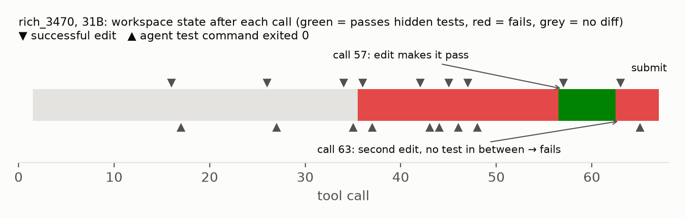
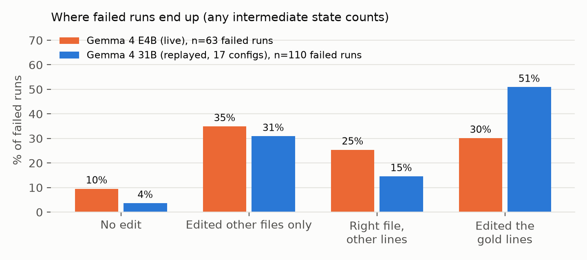

## Abstract

A coding agent is scored on the patch it submits, but it edits the repository many times before that. If an agent had a correct fix at step 30 and broke it by step 60, a simple rule ("keep the last good state") could recover it. Kim et al. showed this *coherence collapse* exists for frontier agents by finding mid-run patches identical to the reference fix. We measure it for Gemma 4 with the hidden tests themselves: we record the workspace diff after every mutating tool call and score each distinct state with the competition's official verifier. The data cover the official sample agent on Gemma 4 E4B (72 valid tasks, run live) and 273 Gemma 4 31B trajectories from 17 agent configurations, rebuilt from public logs by replaying every edit with the harness's own matcher. In total we score 1,431 distinct intermediate states. Lost fixes are rare: 0 of 72 E4B runs and 2 of 273 31B runs (0.7%, 95% CI 0.2–2.6%) passed the hidden tests at some point and submitted a failing patch. 31B broke a passing state 13 times in 12 runs, but repaired it 11 times, 9 of them by reverting to the exact earlier version within a few calls. No selection rule that uses only runtime signals beats the submitted patch; picking the state at the agent's first passing test run loses 13 fixes and gains none (exact McNemar p = 0.0002), because only 48% of the 31B states its own test commands passed on also passed the hidden tests (29% for E4B). Failures are mostly never-reached fixes: 51% of failed 31B runs and 30% of failed E4B runs edited the gold patch's lines without ever producing a passing version. Code, derived per-state labels and the replay tool are released.

## 1. Introduction

The competition asks how far small, local models can go as software engineering agents. Most effort in that direction goes into helping an agent *find* the right code (retrieval, code graphs) or *write* a better fix (fine-tuning, prompting). A third failure mode gets less attention: an agent that wrote a correct fix and then changed it. That failure would be cheap to fix. An agent harness already sees every edit, so it could keep a checkpoint and hand back the best one.

Kim et al. [1] named this failure *coherence collapse* and found it to be the largest theme among frontier-model failures that had reached the right code. Their direct evidence, five trajectories where the agent wrote a patch byte-identical to the reference and later destroyed it, is a floor: most correct patches are not byte-identical to the reference. Their models are also frontier API models, while this competition is about 2–31B models on four L4 GPUs.

We ask three questions about Gemma 4:

- **RQ1. How often does an agent lose a fix?** That is, how often does some intermediate workspace pass the hidden tests while the submitted patch does not?
- **RQ2. When a passing state gets broken, what happens next?**
- **RQ3. Can a rule that uses only what the agent knew at the time pick a better state than the one it submitted?**

The answer to RQ1 decides whether checkpoint-and-restore machinery is worth building for small agents. Our answer is no, and the data say where the effort should go instead.

**Contributions.**

1. **A measurement method** that scores every intermediate state of a trajectory against the hidden tests, with no change to the agent. A 60-line observation hook records the diff live; a replayer rebuilds states from existing logs.
2. **Measurements** on 345 Gemma 4 runs across two model sizes and 18 agent configurations, with every distinct state scored (1,431 states, no sampling).
3. **A counterfactual test of four runtime selection rules**, and a measurement of how well the agent's own test runs predict the hidden tests.
4. **Released resources:** the hook, the replayer, the verification kernels, and per-state pass/fail labels for 67 public tasks. These are derived labels only, as the hosts allow.

## 2. Related work

**Where trajectories go wrong.** SWE-bench [3] made final-patch resolution the standard metric. Kim et al. [1] decompose 16,758 trajectories from seven models into search, read and edit stages against the reference patch. They find that 60–69% of capable-model failures reach and edit the correct functions, and that coherence collapse is the largest theme in that group. Gupta et al. [4] analyse 154k trajectories with solution-distance and backtracking measures. Cuadron et al. [5] show that extended internal reasoning can hurt agentic performance. Our measurement differs from [1] in one respect that matters: we run the hidden tests on every state instead of comparing states with the reference patch, so any correct patch counts.

**Search and selection.** SWE-Search [6] runs Monte Carlo tree search over repository states with explicit backtracking. Agentless [7] and CodeMonkeys [8] sample several candidate patches and pick one using regression and reproduction tests. These methods choose *between* independent attempts. We study selection *within* one attempt, which costs no extra model calls. That is the cheapest place a fix could be recovered, if one were there.

**This competition.** Papasani's audit [2] found that only 68 of the 129 public tasks discriminate between agents, and that 14.7% of planted bugs still pass the tests, so any "resolved" verdict, including ours, is an upper bound on correctness. Showing Gemma 31B the existing tests its patch breaks made it break 16 of 23 held-back correct patches [9], which already suggested that the agent's own test signals can mislead it. A pre-registered study examines edit-state loss at context compaction [10]. sigongjoa [11] show that a 2B agent often cannot land its edits at all. Our results connect these: small agents rarely lose fixes, and their own test signals are not reliable enough to select states with.

## 3. Method

### 3.1 Tasks and validity audit

We use the 129 public development tasks (fastapi 67, rich 48, requests 13, httpx 1) and the official `swegemma` 0.2.11 harness with its subprocess sandbox. Before measuring agents we score every task twice with the official verifier: once with the reference patch, which should pass, and once with an empty patch, which should fail. The reference patch passes on 75 tasks and the empty patch passes on 3. That leaves **72 valid tasks** (rich 43, fastapi 29; no requests or httpx task qualifies). Our valid set contains all 68 tasks of Papasani's independent audit [2] plus four rich tasks. All results below are on valid tasks only.

### 3.2 Agents and runs

**E4B, live.** We ran the official sample submission unchanged except for the model name (`gemma-4-e4b-it-qat-w4a16-ct`) on 4×L4 with vLLM. It has a root agent with six workspace tools, three graph tools and a read-only analyzer sub-agent, with temperature 0.2 and a thinking budget of 4,096. The sample's own `eval_config` allows 10 tool calls and one minute per task, too little to observe a trajectory, so we used 100 tool calls, 100 turns, 10 minutes and a 120 s command timeout. Context compaction used the official notebook's settings, with 8 tasks running at once.

**31B, replayed.** A matching live 31B run was stopped when the weekly GPU quota ran out. Instead we use the 298 public 31B trajectories released by Papasani [2] (Apache-2.0, commit 0758ce1). They span 17 configurations (pilots and ablations over prompts and tool sets) on 67 valid tasks.

### 3.3 Recording intermediate states

*Live.* We wrap the harness's `run_command`, `edit_file`, `write_file` and `submit_patch` functions. After each call the wrapper computes the workspace diff exactly as `submit_patch` does: `git add -N .` and `git diff` against the baseline tag, with test files stripped. It does this against a private copy of the git index, so the agent's own view of the repository is unchanged. It logs the diff, the call, the command's exit code and the submitted patch. Prompts, tools, budgets and sampling are untouched, and the wrapper's git calls count against no budget.

*Replay.* For each logged trajectory we extract the task snapshot and re-apply every `edit_file` call with the harness's own `apply_replacement` matcher and every `write_file` verbatim, recording the diff after each call. The matcher is deterministic, so a replayed edit succeeds exactly when the live edit did. Shell commands that may change files (`rm`, `sed -i`, redirects into the tree, `git checkout`, inline Python writes) are re-executed in the sandbox. A trajectory is kept only if every re-executed command matched its logged success and the replayed final diff equals the patch the original run logged. 273 of 298 trajectories pass both checks. Of the 25 dropped, 24 ended on a different diff and 2 were cut short (one run failed both checks). As a check of the whole pipeline, our verdict on each kept run's final state matches its originally logged verdict in all 269 cases where both exist (E4B: 66 of 66).

### 3.4 Scoring and selection rules

Every distinct non-empty diff of every kept run is scored with `verify_task`. It uses a fresh sandbox, applies the patch, resets test files, applies the hidden `test_patch`, runs pytest and checks the JUnit report. That covers 1,312 31B states and 119 E4B states. States scored more than once never disagreed. A run is **any-time resolved** if any state passes, and has a **lost fix** if it is any-time resolved but its submitted patch fails. A **break** is a step from a passing state to a failing one.

The selection rules may use only what the agent knew at the time:

| Rule | Picks |
|---|---|
| Submitted (harness default) | the last `submit_patch`, else the final workspace |
| Last workspace state | the workspace when the run ended |
| First submitted patch | the first `submit_patch` |
| Last agent-green | the state at the agent's last test-runner command (pytest, unittest, tox, `test_*.py`) that exited 0 |
| First agent-green | the state at its first such command |

Every chosen state was actually reached and scored, so the counterfactual needs no new model calls. Each rule is compared with the submitted patch on the same runs with an exact two-sided McNemar test. Rates carry Wilson 95% intervals.

## 4. Results

### 4.1 Lost fixes are rare (RQ1)

| | Runs | Distinct states per run (median) | Submitted patch resolves | Any state resolves | Lost fixes |
|---|---|---|---|---|---|
| E4B, live | 72 | 1 | 9 (12.5%) | 9 (12.5%) | 0 (0–5.1%) |
| 31B, replayed | 273 | 4 | 163 (59.7%) | 165 (60.4%) | 2 (0.7%, 0.2–2.6%) |

E4B usually makes one change and submits it; the median run has a single distinct state. A model that rarely revises cannot lose a fix by revising, and E4B never did. 31B revises more, with a median of four states, but lost a fix in only 2 of 273 runs. Even if the true rate were at the top of the interval, recovering every lost fix would add under three points to its resolve rate. Both lost fixes are on the same task (`rich_3470`), in two different configurations.

### 4.2 Breaks happen, and the agent usually undoes them (RQ2)

31B broke a passing state 13 times across 12 runs (4.4% of runs). Eleven of the 13 breaks were repaired before the run ended. **Nine repairs were exact reverts to the earlier passing version**, usually within two tool calls; two were new passing versions. Six repairs came right after one of the agent's own checks failed (a reproduction script or pytest exiting non-zero). In practice the agent already runs a small undo loop: edit, check, put it back.

Figure 2 shows one of the two lost fixes. At call 57 the agent's edit to `rich/console.py` makes the hidden tests pass. At call 63, without running anything in between, it edits a second method and breaks it. At call 65 it runs only the scratch tests it wrote itself, which pass, and it submits. In the other lost fix the agent's check after the break did fail (exit 2), and the agent kept going without reverting. Neither case gave a runtime rule a signal it could have used. In the first the agent's own tests went green after the damage; in the second the failing check was there, and only the agent's judgement could have used it.

*Figure 2. The workspace after every call in a 31B run on `rich_3470` (configuration abl3-k4). Green: passes the hidden tests. Red: fails. Grey: no diff yet.*

### 4.3 The agent's own tests are not a reliable selector (RQ3)

| Rule (31B, 273 runs) | Resolved | Lost vs submitted | Gained | p |
|---|---|---|---|---|
| Submitted (harness default) | 163 | — | — | — |
| Last workspace state | 163 | 0 | 0 | 1.0 |
| First submitted patch | 163 | 0 | 0 | 1.0 |
| Last agent-green | 162 | 1 | 0 | 1.0 |
| First agent-green | 150 | 13 | 0 | 0.0002 |

For E4B every rule picks the same 9 resolved runs. The submitted patch is already the best choice a runtime rule can make: no rule gains a single run. Stopping at the first passing test run is significantly worse, because the agent's tests are a weak proxy. Of the 382 31B states at which an agent test command exited 0, **184 (48.2%, CI 43.2–53.2%) passed the hidden tests**; for E4B it is 7 of 24 (29.2%, CI 14.9–49.2%). Agents often test a scratch reproduction written to match their own understanding of the issue, so a green run says the agent's belief holds, not that the issue is fixed.

### 4.4 Most failures never reach a passing patch

If fixes are rarely lost, failed runs must fail before any correct state exists. Figure 1 shows how far they got. 51% of failed 31B runs (56 of 110, CI 41.7–60.1%) edited the lines the reference patch changes (an overlap within three lines of the original file) and still never produced a passing version. This is close to the 60–69% Kim et al. [1] report for frontier models. For E4B the figure is 30% (19 of 63, CI 20.2–42.4%): its failures more often edit only other files (35%) or nothing at all (10%).

*Figure 1. Failed runs grouped by the furthest point they reached, over all intermediate states. "Gold lines" means an agent edit overlapped the reference patch's changed lines within three lines.*

## 5. Discussion

**For people building small agents.** Checkpoint-and-restore machinery has almost nothing to recover for Gemma 4 in this harness: zero lost fixes at E4B and 2 in 273 runs at 31B. The larger model already reverts its own breaks most of the time. The headroom is upstream. E4B's main problem is localization: 44% of its failures never edit the right file. 31B's is fix quality at the right place: half its failures sit on the right lines without a passing version. Rules that end a run early or select a state on the agent's own green test do harm, so a "stop when tests pass" heuristic should not be added without a better test signal. Asking the agent to reproduce the issue with the repository's real test suite, rather than a scratch script, is the obvious next experiment.

**Relation to coherence collapse.** Kim et al. report coherence collapse as the largest theme among capable-model failures. In Gemma 4 it exists, as Figure 2 shows, but at most 2.6% of runs (upper CI bound) and usually self-corrected. One explanation consistent with our data is that the small model revises less: E4B makes one change, and 31B makes a median of four. The more an agent rewrites, the more chances it has to overwrite something good. Fewer revisions shift its failures to never reaching a fix.

**Limitations.**

- Tasks come from two open-source libraries. The hidden test set comes from private repositories, and public-set results have been reported not to transfer [2].
- The 31B data come from another team's 17 configurations, not the sample agent, and the live 31B run was stopped by the GPU quota. So the size comparison also differs in agent configuration and run budget.
- Our "resolved" inherits the tests' blind spots. 14.7% of planted bugs pass them [2], so some "passing" states may be wrong too.
- The replay drops 25 of 298 trajectories whose final diff we could not reproduce.
- We measure states after mutating calls, not inside multi-command shell scripts.
- "Agent-green" is defined by a test-runner pattern and misses reproduction scripts run with plain `python3`.

## 6. Reproducibility

All code is in the GitHub repository and Kaggle notebooks linked below (Apache-2.0). Each step is a Kaggle kernel on the official harness: the live run with the observation hook, the replay, the validity audit and the state scoring. `results/` holds every per-state diff and verdict as derived labels; no competition data is redistributed. `python analysis/analyze.py results/` and `python analysis/reach.py results/ results/gold_hunks.json` print every number in this paper, and `analysis/figures.py` draws the figures. Both analysis scripts carry self-tests (`--selftest`).

**Use of AI tools.** An AI assistant (Claude) helped write code and draft text. Every number was produced by the released scripts from the logged runs, and the author checked the analysis and the final text.

## References

[1] M. Kim, D. Wang, S. Cui, F. Farmahinifarahani, T. Y. Zhuo, S. Garg, B. Ray, R. Mukherjee, V. Kumar. *Coherence Collapse: Diagnosing Why Code Agents Fail After Reaching the Right Code.* arXiv:2603.24631, 2026.
[2] M. Papasani. *gemma4-agentic-swe: audit, ablations and traces for Gemma 4 agents.* github.com/TechNaom/gemma4-agentic-swe, commit 0758ce1, 2026. Apache-2.0.
[3] C. E. Jimenez, J. Yang, A. Wettig, S. Yao, K. Pei, O. Press, K. Narasimhan. *SWE-bench: Can Language Models Resolve Real-World GitHub Issues?* ICLR 2024. arXiv:2310.06770.
[4] Gupta, Chaturvedi, Sengupta, Huan, Deoras. *Dissecting model behavior through agent trajectories.* arXiv:2606.17454, 2026.
[5] A. Cuadron et al. *The Danger of Overthinking: Examining the Reasoning-Action Dilemma in Agentic Tasks.* arXiv:2502.08235, 2025.
[6] A. Antoniades, A. Örwall, K. Zhang, Y. Xie, A. Goyal, W. Wang. *SWE-Search: Enhancing Software Agents with Monte Carlo Tree Search and Iterative Refinement.* ICLR 2025. arXiv:2410.20285.
[7] C. S. Xia, Y. Deng, S. Dunn, L. Zhang. *Agentless: Demystifying LLM-based Software Engineering Agents.* arXiv:2407.01489, 2024.
[8] R. Ehrlich, B. Brown, J. Juravsky, R. Clark, C. Ré, A. Mirhoseini. *CodeMonkeys: Scaling Test-Time Compute for Software Engineering.* arXiv:2501.14723, 2025.
[9] Vein05. *Gemma 4 Gives Its Failing Patches Full Marks* (paper-track entry and code). github.com/Vein05/gemma4-paper-track, 2026.
[10] pedronog8. *Pre-registration: edit-state loss at context compaction.* Kaggle discussion 756850, 2026.
[11] sigongjoa. *Finds the File, Cannot Change It: Why a 2B Coding Agent Fails.* github.com/sigongjoa/gemma4-e2b-edit-failure, 2026.
